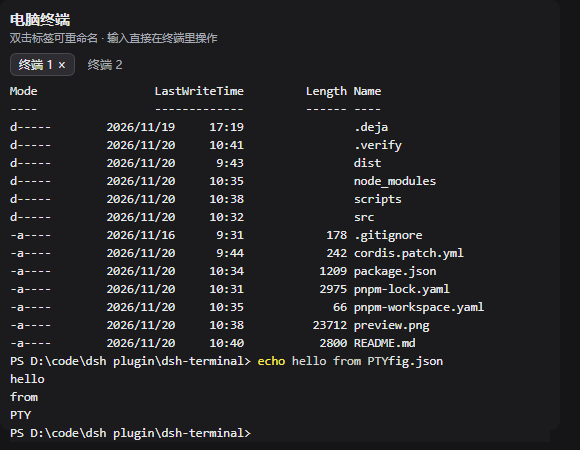

# 电脑终端（dsh-terminal）

> 在 DSH 左侧栏里接入本机真实终端 —— 像用 Windows Terminal 一样敲命令，不再是只能看输出的“假终端”。

### 仓库地址

<https://github.com/sdmu-gaoqi/dsh-terminal>

### 一句话价值

安装后，DSH 左侧栏会多出一个「电脑终端」入口，你可以在对话旁边直接开 PowerShell / cmd / bash 窗口敲命令，命令有回显、有颜色、能 Tab 补全，开多个窗口还能自己改名字。

### 能力分类

**开发与运维**

### 安装命令

从一个克隆好的源码目录安装（推荐，当前版本以源码分发）：

```sh
git clone https://github.com/sdmu-gaoqi/dsh-terminal.git
cd dsh-terminal
pnpm install          # 会顺带执行构建，产出 dist/
```

然后在 DSH 里：**设置 → 插件 → 从本地目录添加**，选中这个目录，重启 DSH。

也可以在 profile 的 `package.json` 里手动加一条依赖：

```json
{
  "dependencies": { "@wagq/dsh-terminal": "link:D:/path/to/dsh-terminal" }
}
```

并把 `"@wagq/dsh-terminal"` 加进 `dsh.profile.bundles`，然后重装依赖、重启 DSH。

> 装完必须**完全退出 DSH 再重新打开**，左侧栏才会出现新入口（DSH 只在启动时加载界面插件）。

### 兼容与运行要求

| 项目 | 要求 |
| --- | --- |
| DSH | 0.2.2 及以上 |
| 平台 | Windows（ConPTY）、macOS、Linux |
| 默认 Shell | Windows 为 PowerShell，macOS/Linux 为 `$SHELL` |
| 可选 Shell | `pwsh`、`cmd.exe`、`bash`（依赖系统已安装） |

### 许可证

MIT

### 截图 / 演示



真实 PowerShell 输出的渲染效果：命令回显、结果分行、提示符完整。

### 补充说明

**权限**
- 命令以当前用户身份、在会话工作区目录下执行，与你自己开终端等价。
- 终端服务只绑定本机回环地址，并校验请求来源，不接受外部访问。

**数据**
- 不访问外网、不上传任何内容。命令和输出都留在这台机器上。
- 前端用到的终端渲染组件（xterm）由本插件从本机服务加载，不走公网 CDN。
- 每个窗口的滚动输出上限约 60 万字符，超出后自动丢弃最早的。

**已知限制**
- 关闭 DSH 时，所有终端窗口及其进程会一并结束（不跨重启保留）。
- 界面插件在 DSH 启动时加载，安装或升级后必须重启才生效。
- 首次打开 PowerShell 窗口会稍慢（约 1 秒），属正常现象。
- 当前版本以源码方式分发，尚未发布到 npm。

### 提交前自查

- [x] 仓库已公开
- [ ] 已添加 GitHub topic：`dsh-plugin`
- [x] README 包含安装命令
- [x] 插件导出 `apply(ctx)` 模块
- [x] 仓库根目录包含 `package.json`
